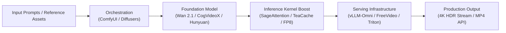

  

# 🎬 Awesome AI Video Processing & Inference Optimization ⚡

**A curated index of cutting-edge SaaS platforms, foundation video models, avatar pipelines, and high-performance inference optimization engines.**

*Discover, benchmark, and deploy text-to-video (T2V), image-to-video (I2V), video understanding, talking heads, and sub-second GPU acceleration runtimes.*

---

## 📌 Table of Contents 📑

- [📊 Sector Overview & Market Dynamics](#-sector-overview--market-dynamics)
- [🏢 SaaS & Hosted Commercial Platforms](#-saas--hosted-commercial-platforms)
- [💻 Open-Source GitHub Projects](#-open-source-github-projects)
- [⚙️ Recommended Framework Stack](#-recommended-framework-stack)
- [🤝 How to Contribute](#-how-to-contribute)
- [☕ Support](#-support)
- [📈 Star History](#-star-history)
- [⚠️ Disclaimer](#️-disclaimer)

---

## 📊 Sector Overview & Market Dynamics 🌐

The global **AI video generation and processing market** is estimated at approximately **$700M to $1B+** in 2024–2025 and is projected to expand beyond **$3.5B to $6B+** by 2030, compounding at a CAGR of **>20%**. 

The sector exhibits distinct market dynamics across its architectural layers:
* **Foundation Model & Compute Layer (Highly Concentrated / Oligopoly):** Building frontier video generation transformers requires massive GPU clusters (10,000+ accelerators) and capital intensive pretraining runs ($10M–$100M+). Consequently, foundational generative video models are dominated by an oligopoly of well-capitalized tech conglomerates and heavily backed AI labs (e.g., Kuaishou Kling, Runway, Luma, Google, Tencent).
* **Application & Downstream Vertical Layer (Moderately to Highly Fragmented):** Downstream use cases—such as synthetic corporate training avatars, conversational sales agents, automated short-form marketing editors, localization/dubbing tools, and multimodal enterprise video search—are fragmented across hundreds of specialized SaaS startups competing to solve end-to-end customer workflows.

---

## 🏢 SaaS & Hosted Commercial Platforms ☁️

*Curated hosted platforms for production generative video, conversational avatar APIs, and enterprise multimodal video indexing. Ranked by company valuation and annualized revenue run rate.*

| 🏷️ Platform | 💰 Valuation / Revenue | 💳 Starting Paid Price | 🎁 Free Tier / Trial Limits | 📝 Description |
| :--- | :--- | :--- | :--- | :--- |
| **[Kling AI](https://klingai.com/)** | $18.0B est. unit val. / ~$240M–$500M ARR | $6.60/month (Standard, ~660 credits/mo) | 66 credits/day free forever (resets every 24h, non-rolling; ~3–6 short clips/day; watermarked, non-commercial) | Advanced text-to-video and image-to-video platform with high motion quality, commercial creative tools, and cinematic rendering capabilities. |
| **[Runway Gen-3](https://runwayml.com/)** | $5.3B val. / $200M+ ARR | $15.00/month (or $12/mo billed annually for Standard, 625 credits/mo) | 125 one-time credits upon sign-up (~25s of video; one-time allotment, never renews; watermarked, non-commercial, 5 GB storage) | Leading generative video suite (Gen-3/Gen-4) for text-to-video, image-to-video, and creative editing workflows with professional editor plugins. |
| **[Luma Dream Machine](https://lumalabs.ai/)** | $4.0B val. / ~$65M–$80M ARR | $9.99/month (Lite, ~3,200 credits/mo; $30/mo for Plus with commercial rights) | ~80 credits/day free forever (~1 video generation/day; resets daily, non-rolling; watermarked, non-commercial) | High-quality generative video API and studio focused on cinematic motion and rapid generation from prompts or images. |
| **[Synthesia](https://www.synthesia.io/)** | $4.0B val. / $150M+ ARR | $29.00/month (or ~$18/mo billed annually for Starter, 1,200 credits/mo) | 1,200 credits/month free forever (~10 minutes of video/month; watermarked, direct MP4 downloads disabled, personal use only) | AI avatar and talking-head platform for corporate training, marketing, and multilingual localized video production. |
| **[Pika Labs](https://pika.art/)** | ~$500M–$700M val. | $10.00/month (or $8/mo billed annually for Starter, ~600 credits/mo) | Free forever exploration account with 0 recurring monthly credits (sign-up provides dashboard access and up to 2 parallel tasks; video generation requires credit pack purchase or plan upgrade) | Creative text-to-video and image-to-video product tailored for social and short-form content generation and VFX effects. |
| **[HeyGen](https://www.heygen.com/)** | $500M val. / $200M+ ARR | $29.00/month (or $24/mo billed annually for Creator, 600 credits/mo) | Free tier providing up to 3 videos/month (max 1 minute duration per video; watermarked, non-commercial evaluation only) | Avatar video generation with lip-sync, real-time translations, and template-driven talking-head workflows for marketing and sales. |
| **[D-ID](https://www.d-id.com/)** | ~$350M+ est. val. / ~$30M–$54M ARR | $5.90/month (Lite, ~10–16 minutes/mo) | 14-day free trial with 3 minutes of video generation total (one-time allocation; full-screen watermark, max 30s translations, strictly non-commercial) | Talking-head and digital-human APIs that animate facial images and drive real-time speech-aligned conversational video agents. |
| **[Twelve Labs](https://www.twelvelabs.io/)** | ~$200M+ total funding / ~$15M–$18M ARR | $29.00/month (Plus plan, 50 GB storage, medium workloads) | Free plan offering up to 3 GB asset storage (~600 minutes of video indexing free forever; shared basic rate limits) | Video understanding platform offering multimodal embeddings and APIs for search, classification, and insight extraction from long-form video. |
| **[Tavus](https://www.tavus.io/)** | ~$70M–$150M est. val. / ~$5M–$10M ARR | $22.00/month (Builder tier, custom face slots and developer API access) | Free tier providing 20–25 Conversational Video Interface (CVI) minutes/month (concurrency capped at 1 active session; sandbox testing only) | Personalized conversational video and interactive avatar APIs for automated sales outreach, real-time agents, and support experiences. |

---

## 💻 Open-Source GitHub Projects 🛠️

*Top open-source foundation video models, diffusion pipelines, inference acceleration kernels, and talking avatar repositories. Sorted descending by GitHub stargazers count.*

1. **[ComfyUI](https://github.com/comfyanonymous/ComfyUI)**   
   The modular, node-based visual workspace and backend execution graph that serves as the gold standard for running, fine-tuning, and chaining open video diffusion pipelines locally.

2. **[Hugging Face Diffusers](https://github.com/huggingface/diffusers)**   
   The foundational Python library for state-of-the-art diffusion models, serving as the standard ecosystem for text-to-video, image-to-video, schedulers, and LoRA adaptation.

3. **[Open-Sora](https://github.com/hpcaitech/Open-Sora)**   
   Colossal-AI's high-performance, fully open-source reproduction of large-scale video diffusion models, including efficient distributed training recipes and inference tooling.

4. **[LivePortrait](https://github.com/KwaiVGI/LivePortrait)**   
   Efficient, high-fidelity portrait animation and video-driven talking-head generation with precise facial stitch, eye gaze control, and cross-identity driving.

5. **[Wan 2.1](https://github.com/Wan-Video/Wan2.1)**   
   State-of-the-art open foundation video model suite (1.3B and 14B parameter DiT models) from Alibaba under Apache-2.0, supporting 720p/1080p generation and full Diffusers/ComfyUI integration.

6. **[SadTalker](https://github.com/OpenTalker/SadTalker)**   
   Learning Realistic 3D Motion Coefficients for stylized audio-driven single-image talking face generation with expression control.

7. **[CogVideoX](https://github.com/THUDM/CogVideo)**   
   Zhipu AI's flagship open-source video generation models (CogVideoX-2B and CogVideoX-5B) featuring 3D causal VAEs and expert DiT architectures optimized for lower VRAM.

8. **[HunyuanVideo](https://github.com/Tencent/HunyuanVideo)**   
   Tencent's frontier 13B parameter open-source video generative model featuring a unified dual-stream and single-stream DiT architecture for high-resolution video synthesis.

9. **[AnimateDiff](https://github.com/guoyww/AnimateDiff)**   
   Pioneering motion module framework that animates personalized text-to-image diffusion models without needing dedicated video fine-tuning.

10. **[Open-Sora-Plan](https://github.com/PKU-YuanGroup/Open-Sora-Plan)**   
    Community-driven open research initiative from PKU and YuanGroup aimed at reproducing high-definition, long-duration video generation models with open data recipes.

11. **[LTX-Video](https://github.com/Lightricks/LTX-Video)**   
    Lightricks' real-time capable DiT video generation architecture capable of synthesizing high-resolution video clips faster than playback speed on modern GPUs.

12. **[Hallo](https://github.com/fudan-generative-vision/hallo)**   
    Hierarchical audio-driven visual synthesis for portrait image animation with expressive lip-sync and lifelike head motion.

13. **[vLLM-Omni](https://github.com/vllm-project/vllm-omni)**   
    High-throughput, low-latency omni-modal serving runtime extending vLLM to support video generation and multimodal diffusion serving at scale.

14. **[Video-Retalking](https://github.com/vinthony/video-retalking)**   
    Audio-based lip synchronization and facial expression editing system for talking heads in arbitrary in-the-wild videos.

15. **[VideoCrafter](https://github.com/AILab-CVC/VideoCrafter)**   
    Open toolkit for high-quality text-to-video and image-to-video synthesis, camera motion control, and high-resolution video restoration.

16. **[SageAttention](https://github.com/thu-ml/SageAttention)**   
    Plug-and-play, accurate 8-bit quantized attention kernel providing 2x–3x speedups for video diffusion transformers (DiTs) with zero quality loss.

17. **[Mochi](https://github.com/genmoai/mochi)**   
    Genmo's 10B open-weights Asymmetric Diffusion Transformer (AsymmDiT) capable of cinematic motion and high prompt fidelity under Apache-2.0.

18. **[FreeVideo](https://github.com/FlashML-org/FreeVideo)**   
    Ultra-efficient inference engine enabling MiniMax H3-class video models to run locally on consumer GPUs with as little as ~8 GB VRAM.

19. **[TeaCache](https://github.com/ali-vilab/TeaCache)**   
    Timestep Embedding Aware Caching algorithm that slashes inference latency by 2x–3x in video diffusion models without retraining.

20. **[Native Video Inference](https://github.com/creatify-ai/native-video-inference)**   
    Lightweight, optimized C++ and CUDA serving runtime focused on ultra-fast cold starts and minimal idle GPU overhead for video pipelines.

---

## ⚙️ Recommended Framework Stack 🧩

For teams building self-hosted, scalable video generation infrastructure:

* **Foundation Models:** Choose **Wan 2.1** (balanced speed & photorealism) or **HunyuanVideo** (extreme visual fidelity).
* **Speedup Kernels:** Integrate **SageAttention** (INT8/FP8 attention acceleration) and **TeaCache** (skipping redundant DiT steps).
* **Local VRAM Constraints:** Utilize **FreeVideo** or **ComfyUI-GGUF** offloading for 8GB–16GB consumer RTX cards.
* **Serving Production:** Deploy via **vLLM-Omni** for high concurrency and dynamic batching.

---

## 🤝 How to Contribute 💡

We welcome contributions from the community! To suggest a new project, runtime, or updated pricing:

1. 🍴 **Fork** the repository.
2. 🌿 **Create a branch**: `git checkout -b feature/add-new-video-tool`.
3. 📝 **Edit `README.md`**: Follow the established format, ensuring all SaaS entries provide explicit pricing and exact free tier limits, and open-source repositories include Stars_Badges.
4. 🚀 **Submit a Pull Request** with a concise description of the library and its license.

---

## ☕ Support 💖

If you found this curated list helpful for your research, workflow, or infrastructure builds, please consider supporting the project:

- ⭐ **Star this repository** to help others discover it.
- 🍴 **Fork and share** it across your network and community.
- ☕ **Sponsor the maintainer** via GitHub Sponsors:  
  

---

## 📈 Star History 🌟

---

## ⚠️ Disclaimer ⚖️

- This is an independently curated open-source community resource. All product names, logos, and brands belong to their respective owners.
- Open-source video model licenses vary widely (e.g., Apache-2.0, MIT, custom community licenses with commercial revenue boundaries). Always verify license terms on each upstream repository before deployment.

---

  Maintained with ❤️ by <a href="https://github.com/ishandutta2007">Ishan Dutta</a> and the open-source AI video community.

